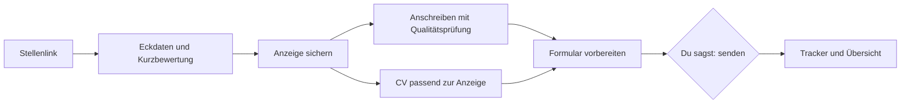

# Bewerbungspilot

**Dein KI-Agent für Werkstudentenjobs, Praktika und Abschlussarbeiten.** Er sucht Stellen, schreibt Anschreiben, schneidet deinen Lebenslauf auf jede Anzeige zu und füllt Bewerbungsformulare aus. Du prüfst und klickst auf Senden.

Läuft mit [Claude Code](https://claude.com/claude-code), [Codex](https://github.com/openai/codex) und jedem Agenten, der `AGENTS.md` liest. Alles bleibt lokal, deine Daten landen nie im Repo.



## Was er kann

| | |
|---|---|
| **Stellen finden** | Recherche nach deinen Kriterien, jede Stelle wird auf der Originalseite geprüft (offen, Ort, Studiengang, Dauer). |
| **Anschreiben** | Vier kurze Absätze, nur Fakten aus deinem Profil, automatisch geprüft auf Floskeln, KI-Klang und Platzhalter. Ergebnis ist eine saubere Ein-Seiten-PDF. |
| **CV pro Stelle** | Passende Projekte und Skills nach vorn, Sprache der Anzeige (DE oder EN), neu formulierte Stichpunkte nur aus echten Fakten. |
| **Formulare** | Der Agent füllt Felder und Uploads im Browser aus (optional). Login, Einwilligungen und CAPTCHAs bleiben bei dir. |
| **Tracker** | `uebersicht.html` zeigt jede Bewerbung mit Anzeige, Anschreiben und dem verwendeten Lebenslauf. Mail-Abgleich für Absagen und Einladungen (optional). |

## Schnellstart

**1. Voraussetzungen**
- Claude Code **oder** Codex CLI
- Python 3
- tectonic und poppler für die PDFs
  - macOS: `brew install tectonic poppler`
  - Linux: tectonic laut [tectonic-typesetting.github.io](https://tectonic-typesetting.github.io), dazu `sudo apt install poppler-utils`

Optional: Browser-Steuerung ([Claude in Chrome](https://claude.ai/chrome) oder ein Playwright-MCP), Gmail-Connector, `agy` (Google Antigravity CLI) für ausgelagerte Websuche und Entwürfe.

**2. Repo holen und Agent starten**
```sh
git clone https://github.com/muratonuryahsi-sudo/bewerbungspilot.git
cd bewerbungspilot
claude        # oder: codex
```

**3. Einrichten (ca. 15 bis 20 Minuten)**

Claude Code: `/einrichtung`, Codex: `einrichtung starten`. Der Agent liest deinen Lebenslauf ein, baut daraus dein Profil, legt den Unterlagen-Ordner fest und macht einen Testlauf. Alles, was nicht belegt ist, bleibt leer.

## Benutzen

| Du sagst | Was passiert |
|---|---|
| Stellenlink schicken (`/bewerbung https://...`) | Kurzbewertung, auf Wunsch Anschreiben und CV, mit "bewerben" das Formular |
| `Jobs suchen` | Recherche nach deinen Suchkriterien, Top-Liste mit geprüften Links |
| `Status` | Mails abgleichen, Tracker aktualisieren |
| `uebersicht.html` öffnen | Überblick über alle Bewerbungen |

Vor dem Absenden zeigt der Agent immer eine kurze Zusammenfassung und wartet auf dein "senden".

## Qualität statt Masse

**Anschreiben.** Die Regeln stehen in [`docs/anschreiben_regeln.md`](docs/anschreiben_regeln.md), der Hintergrund in [`docs/anschreiben_protokoll.md`](docs/anschreiben_protokoll.md). Vor dem Bau läuft `tools/anschreiben_lint.py`.

- Fehler brechen den Bau ab: Floskeln, Gedankenstrich, Doppelpunkt im Satz, Platzhalter, mehr als 300 Wörter.
- Warnungen zeigen Verbesserungen: KI-typische Wörter, Firmenname fehlt, zu lange Absätze, zu viele Sätze mit "Ich", Zahlen, die nicht in deinem Profil stehen.
- Sonderzeichen werden automatisch escaped, unsichtbare Unicode-Zeichen entfernt.
- Gebaut wird nur eine PDF ohne Links und aktive Inhalte, schwarz-weiß, eine Seite.

**CV pro Stelle.** Mit `cv_daten.json` (entsteht in der Einrichtung) wählt `tools/cv.py` Projekte, Stichpunkte und Skills nach den Begriffen der Anzeige und formuliert vorhandene Erfahrung passend um. Verlangt die Anzeige etwas, das du nicht kannst, taucht es nicht auf. Das Tool lehnt Tools und Zahlen ab, die nicht in deinen Fakten stehen.

## Aufbau

| Datei / Ordner | Zweck |
|---|---|
| `AGENTS.md` | Regeln für jeden Agenten (`CLAUDE.md` und `GEMINI.md` verweisen darauf) |
| `skills/einrichtung`, `skills/bewerbung` | Abläufe, verlinkt nach `.claude/skills` und `.agents/skills` |
| `docs/` | Anschreiben-Regeln und Hintergrund |
| `vorlagen/` | Vorlagen für Profil, Einstellungen, Anschreiben und CV |
| `tools/` | Tracker, Anschreiben mit Prüfung, CV pro Stelle, Uploads, optional agy |
| `portale.md` | Erfahrungen mit Bewerbungsportalen (Taleo, Workday, StepStone, SuccessFactors …) |
| `profil.md`, `cv_daten.json`, `einstellungen.json`, `bewerbungen.json`, `bewerbungen/` | deine Daten, nur lokal (`.gitignore`) |

## Prinzipien
- **Nur echte Fakten.** `profil.md` ist die einzige Quelle. Lücken werden ehrlich benannt.
- **Du behältst die Kontrolle.** Kein Absenden ohne dein "senden", keine Einwilligungen oder Logins durch den Agenten.
- **Privat.** Profil, Tracker, Anschreiben und Unterlagen bleiben auf deinem Rechner.
- **Sparsam.** Erst Eckdaten prüfen, dann arbeiten. Passt die Stelle nicht, hörst du es sofort.

## Tests
```sh
python3 -m unittest discover -s tests -v
```

## Mitmachen
Neue Erkenntnisse zu Bewerbungsportalen gerne per Pull Request in `portale.md`, ohne persönliche Daten. Fehler und Ideen als Issue.

## Hinweis für Windows
Die Skill-Ordner `.claude/skills` und `.agents/skills` sind Symlinks. Unter Windows `git config core.symlinks true` setzen (mit Entwicklermodus) oder die Ordner aus `skills/` dorthin kopieren.
